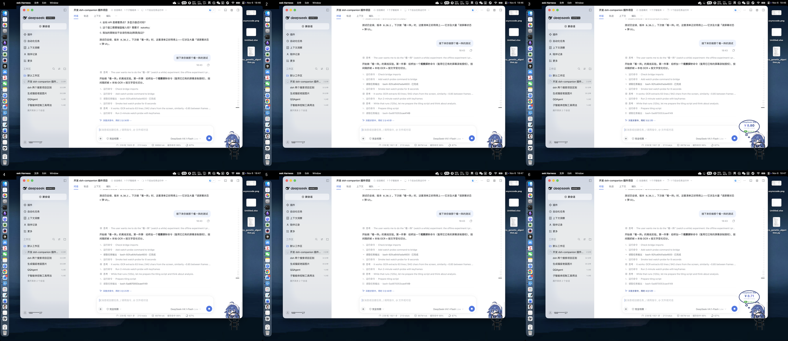
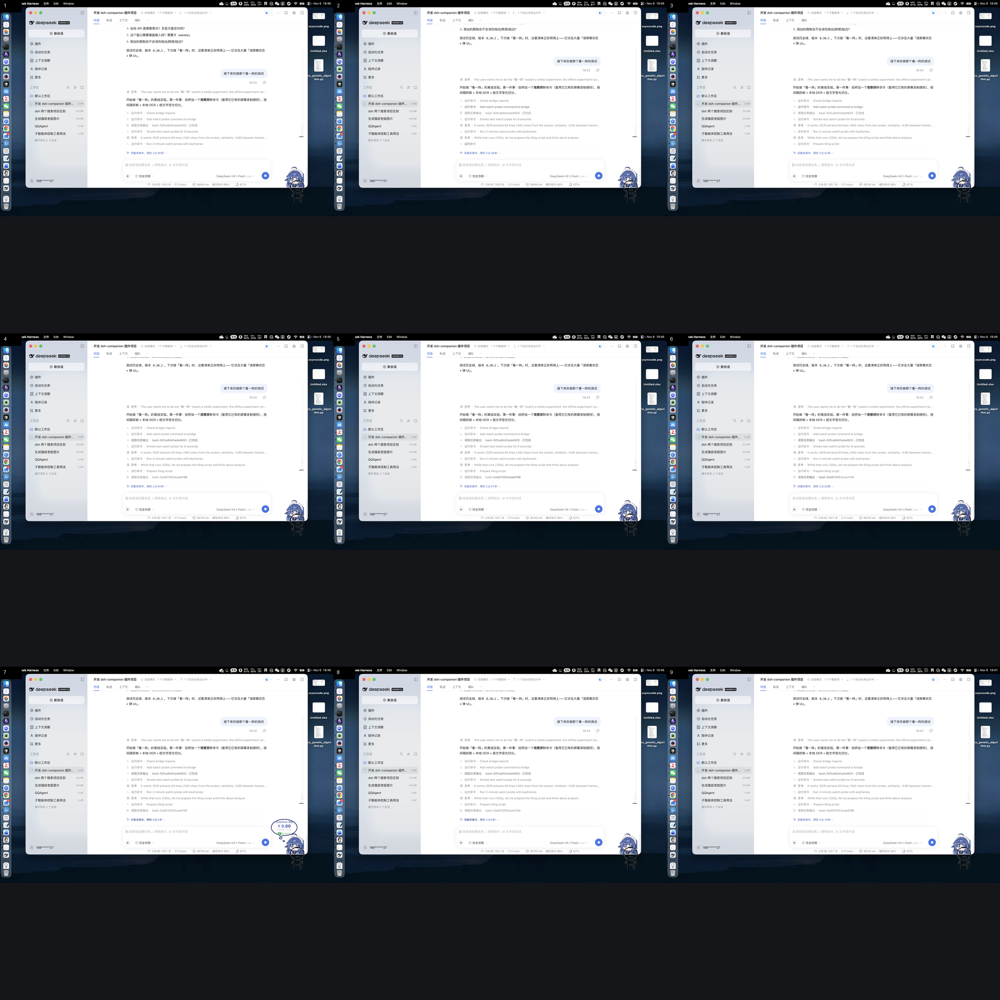

# 「看一阵」可行性实验（2026-11-07）

> 目的：在写正式功能之前，用**不花 token** 的方式验证两件事——
> ① 屏幕内容能不能靠「文字变化」切分成有意义的状态；② 多帧拼图后模型能不能看清。
>
> 结论先说：**OCR 可用；按文字相似度切分在流式内容上不可靠；拼图应保持画面比例。**

---

## 1. 工具

桥里新增了 `watchprobe` 命令（`bridge/DshBridge.swift`），复用宿主已有的屏幕录制授权：

```bash
dsh-bridge watchprobe --seconds 120 --interval 2 \
  --threshold 0.85 [--min-run 2] [--drift] [--additive] \
  --out /tmp/probe.jsonl [--keep-dir /tmp/keep]
```

每帧：`screencapture` 截图 → Vision OCR（zh-Hans + en-US，accurate）→ 归一化行集合 →
与基准做 Jaccard 相似度 → 低于阈值则切一个新「状态」并（可选）保存关键帧。

参数含义：

| 参数 | 作用 |
|---|---|
| `--threshold` | 相似度低于它就算新状态（默认 0.85） |
| `--min-run` | 连续 N 帧都低才切（滞回，防抖动） |
| `--drift` | 与「上一个保留状态」比，而不是与上一帧比（防缓慢漂移） |
| `--additive` | 纯追加（旧行是新行的子集）视为同一状态 |

原始数据：`watch-probe-sample.jsonl`（120 秒、42 帧）。

## 2. 结果

### 2.1 OCR

| 指标 | 值 |
|---|---|
| 每帧识别行数 | 60–70 行 |
| 每帧字符数 | 1000–1400 |
| 中文识别 | 可用（DSH 面板、网页正文都能读） |
| 单帧耗时 | 约 0.3–0.5s（含截图与 OCR） |

### 2.2 切分（每次 60 秒，阈值 0.85）

| 条件 | 帧数 | 状态数 | 平均状态时长 |
|---|---|---|---|
| 基线（每帧比较） | 19 | 12 | ~5s |
| drift + min-run 2 | 20 | 10 | ~6s |
| drift + min-run 2 + additive | 20 | 15 | ~4s |

> ⚠️ 三次跑的**屏幕活动不同**（我在改文件、对话在流式输出），所以数字不能严格横向比较。
> 但结论一致：**参数怎么调，状态数都在 10–15/分钟这个量级**，远超「每分钟 1–2 个有意义场景变化」的预期。

### 2.3 拼图可读性

| 版式 | 尺寸 | 帧数 | 结论 |
|---|---|---|---|
| 3×3 正方形裁切 | 2160×2160 | 9 | 文字可读，但**每格裁掉了约 40% 画面**（屏幕是 16:10） |
| **3×2 保持比例** | **2160×936** | **6** | 文字清晰、UI 完整，**像素只有前者的 43%** |




## 3. 三条关键结论

### 3.1 「按文字变化切分」不适合流式内容，别把它当分段器

聊天、日志、构建输出是**持续追加/滚动替换**的：每 2 秒文字集合都变，相似度天然掉到 0.85 以下。
`additive` 只能救「只增不减」的情况，滚动替换时无效。

**正确用法：把相似度当「去重过滤器」，而不是「分段器」。**

- 固定窗口（如 30 秒）产出一个片段
- 窗口内按相似度抽样，跳过几乎相同的帧
- 由模型读「这一个窗口的代表帧 + OCR 文本」来概括，而不是先切出「状态」

这与 Screex 的经验一致：它明确写了连续运动内容会过度切分，建议用更粗的模式。

### 3.2 拼图必须保持画面比例

16:10 的屏幕硬裁成正方形，浪费近一半像素；同样的可读性，3×2 只要 43% 的像素。
**规则：按源画面的宽高比铺格，宁可少放两帧，也不要裁。**

### 3.3 成本结构已经可以估算

以 30 分钟、每 30 秒一个窗口计算：

| 项 | 数量 | 成本量级 |
|---|---|---|
| 窗口数 | 60 | — |
| 每窗口 1 张 3×2 拼图 | 60 张（2160×936 ≈ 2.0MP） | 视觉 token 的主要来源 |
| 每窗口 OCR 文本 | 约 4–6k 字符 | 便宜 |
| 增量摘要 | 60 次短调用（可合并成 10 次） | 便宜 |

按每张拼图约 1.5k 视觉 token 粗估：60 张 ≈ 90k token；若每 2 个窗口才出一张，可降到 45k。

## 4. 对正式实现的设计建议

1. **采样**：`screencapture` 每 2 秒一帧在实验里完全可用（单帧 0.3–0.5s，CPU 可接受）。
   正式实现若嫌重，再换 ScreenCaptureKit。
2. **切分**：按固定窗口（30s）产出片段；相似度只用来抽样去重，不做语义分段。
3. **拼图**：3×2、保持 16:10、每格 720px；窗口内取 6 帧（每 5 秒一张）。
4. **预算**：默认「每 2 个窗口 1 张图」，即 30 分钟约 30 张；提供「高频/低频」两档。
5. **存储**：每窗口存 OCR 文本 + 一张拼图缩略；原帧不必留（关键帧由拼图承担）。
6. **提问**：先检索 OCR 文本定位时间窗，再取该窗口的拼图给模型。

## 5. 未验证 / 风险

- **多显示器**：探针只抓主屏；正式实现要决定「只抓主屏」还是「抓当前焦点屏」。
- **隐私**：连续截屏涉及会议/聊天；必须显式开始停止，并在桌宠上给出持续状态提示。
- **音频**：本次完全不涉及；会议场景若要「听懂」，需要额外做转写，属独立模块。
- **长会话成本**：60 张拼图已是 90k token 量级，需要预算上限与自动降级（比如只保留变化大的窗口）。
- **滚动替换内容的判定**：本次没有找到可靠的低成本信号，只能靠「固定窗口 + 抽样」绕开。

---

## 6. 设计修订（第二次讨论，2026-11-07）

第一次实验的结论里，有三条被后续讨论修正。原文保留在上面，这里记修订结果与依据。

| 项 | 实验结论（第一次） | 修订后 | 依据 |
|---|---|---|---|
| 窗口内取几帧 | 每 5 秒抽 6 帧（3×2 拼图） | **去重后选 ≤9 帧**，3×3 拼图 | 见下「选帧」 |
| 拼图版式 | 3×2 保持 16:10 | **3×3 保持 16:10，单格 720px** | 保持比例后 3×3 每帧 292k 像素 < 3×2 的 337k，且多装 3 帧。旧结论来自「16:10 硬裁正方形」的浪费，前提不成立 |
| 成本控制 | 每 2 个窗口 1 张图 + 硬预算 | **每窗口最多 1 张；三档预警（5万/15万/30万 token）不停止录制** | 硬上限会在关键时刻掐断且不可感知；预警 + 采样率下拉把「消耗速率」交给用户 |

### 选帧：先去重、再按信息量挑、保证时间覆盖

外部依据（只列结论，不引原文）：

- **M-LLM 帧选择（CVPR'25）**：明确反对「均匀采样」，主张按相关性挑帧。
- **CueKFS**：线索/意图驱动挑关键帧，长视频优于均匀采样。
- **Attention-based selector（EMNLP'25 findings）**：预算约束下用动态规划联合优化「候选池大小 + 每帧 token 分配」。
- **bili-whale**：六路互补（字幕/弹幕/热评优先，抽帧只在深读时用），九宫格拼图凑一次调用。

共同点：**不是均匀取几张，而是先去除重复，再按信息量挑，并保证时间覆盖**。

落地成廉价版算法（纯本地、不花 token）：

```
15 帧 / 30 秒窗口
 ├─ 1. 去重：相邻帧相似度 > 0.9 合并 → D 帧
 ├─ 2. |D| ≤ 9：全留
 └─ 3. |D| > 9：30 秒切 9 个时间桶，每桶取信息量最大的一帧
        信息量 = 新增 OCR 文本行数（差分）+ 画面锐度（拉普拉斯方差）
```

### 录制期的交互（新增）

- 常驻气泡改成固定两行的**控制条**：`● 录制中 12:30 · 25 窗口 · 150 帧 · ≈45k token`，
  下面一行是 `[⏸ 暂停] [⏹ 停止] [✕ 丢弃] [2s ▾]`。
- 采样率下拉 2s / 5s / 10s / 20s，切换立即生效。
- 点按钮不触发「打开记录」，点非按钮区域才展开时间线。
- 气泡高度固定，不随文字变（避免录制中窗口一直跳）。

---

## 7. 外部项目评审（2026-11-07，13 个仓库）

逐条结论只写「对看一阵有什么用」，不写项目简介。

### 7.1 `c1overzz/dsh-bili-scroll`（重点）

| 做法 | 采纳 | 说明 |
|---|---|---|
| **先读原文再判断，不看摘要**；没字幕的演示类才抽帧看画面 | ✅ | 看一阵同理：**OCR/文本是主证据，图是补充**。默认不出图，只对"画面驱动"的窗口升级 |
| 每轮只给**六个只读工具**、路径写死、没有文件系统/联网 | ✅（架构上天然满足） | 看一阵的分析走插件内部 `llm.stream`，不经 agent 工具，天然窄 |
| **判重表**：同一内容不重复处理 | ✅ | 帧指纹表：同一画面不重复 OCR、不重复进拼图 |
| **值班章程版本账本**（`charter.sha256`）：用户没改过就自动升级，改过就另存 `.new` | ✅（建议补到插件） | 我们的 `prompt.json` 覆盖缺这个账本：将来改默认模板时，无法区分"用户改过"与"没改过" |
| 峰谷/成本意识，每轮条数上限 | 部分 | 我们用三档预警 + 采样率调节，不做硬上限 |

**最大的一条修正**：`每窗口 1 张拼图` 太贵也没必要。文本先行的做法是——先看 OCR 原文，
只有文字不足以回答（视频、游戏、图表、纯图片界面）才把画面拼上去。

### 7.2 `SAOS-3624/dsh-video-storyboard`

- **格子大小 = 该位置切点密度（8 档 1/k）**，按行 DP 打包、裁到内容、填充率 <68% 补帧 —— ✅ 直接采纳。
  它把「固定宫格假设每帧同样重要」这个问题讲透了，实测：长镜头 4 倍清晰度、快剪不再被压成色块。
- **帧 = 镜头**（真切点切段 + 积分采样补段），时间轴永远连续 —— ✅ 采纳。
- **像素计费**：42px 一格，`rows×(cols+1)+2`，单图 token 与格子数无关、与像素有关 —— ✅ 用来校准我们 1.5k/图 的估算。
- **auto 档**：张数只按时长算（240s/张），预算内挑最省档，`dryRun` 先问成本 —— ⚠️ 部分采纳：
  我们按时长/窗口数给张数预算，但不需要"档位枚举"，规则写死更省心。
- **切点算法**：64×36 HSV 环形色相 + 饱和降权、自适应阈值、2 秒窗口爆点重判 —— ✅ 采纳，替换我们的文本相似度分段。

### 7.3 `SAOS-3624/dsh-watch-together`

- **变速启动**（ramp 60/120/180/240 秒）：开头短、逐段加长，第一次开口不用等满 —— ✅ 采纳（10s/15s/30s 起步）。
- **双缓冲**：永远留一个批次在后面，交付实测 0.0 秒 —— ✅ 采纳（下一窗口 OCR/拼图提前算）。
- **lead 15 秒**：不是段末才交付，留出插话余量 —— ⚠️ 录制场景没有"播放进度"，改为"窗口结束前 10% 完成本地准备"。
- **进度读数与失效策略**（新鲜/外推/错过一次/连续错过）：录制没有播放进度，但**采集缺口**要同样分档标注，
  不能用墙钟假装连续 —— ✅ 采纳（掉帧、最小化、睡眠都要在时间线上留洞）。

### 7.4 `ilps2/dsh-video-understand`

- **信息层（ASR + 场景 + 轨迹 + YOLO）替代逐帧像素**，约 1k token；同视频内容哈希缓存复用 —— ✅ 方向一致：
  我们的"OCR 文本层 + 时间线"就是信息层；补上**内容哈希缓存**（同一窗口重复画面不重复 OCR）。

### 7.5 `yangjili6/video-understanding-kit`

- **5–12 FPS 密集采样 + 网格页 + 场景分组** —— ❌ 不采纳：太贵，且我们的对象是桌面不是视频。
- **索引结构** `index.json`（groups/pages/frames、时间戳、耗时、边界）—— ✅ 采纳为记录里的 `timeline` 结构。
- 明确写"帧差峰值可能来自转场，不能当动作发生时刻" —— ✅ 提示词里要写同样的免责。

### 7.6 `Sacredbluedragon/dsh-bili-watch`

- **层级降级**：官方字幕 → 本地转写 → 画面认字，每级失败都写进"来源"行 —— ✅ 采纳
  （看一阵：OCR 失败就说"这段没识别到文字"，不编）。
- **画面索引格式** `r1c1 00:00-00:05 @00:02` —— ✅ 采纳（拼图格子与时间线共用同一套编号）。
- **缓存与保留策略**（默认 7 天 / 2GB，只删可证明归属的条目） —— ✅ 采纳。

### 7.7 `oxbshw/watch-skill`

- **observe → act → verify**、**Measured, not asserted** —— ✅ 精神采纳：录制结束必须给可验证产物
  （时间线 + 每格时间戳 + 哪些秒没采到），而不是只给一段摘要。

### 7.8 其余（结论：只做参考，不采纳）

| 项目 | 结论 |
|---|---|
| `Alterssss/dsh-bili-whale` | 六路互补（字幕/弹幕/热评/抽帧/封面/简介）+ `--substrip` 把字幕带裁成一张长图。**"文本一张长图"** 对看一阵有启发，但我们 OCR 已是文本，不需要拼字幕条 |
| `whiteguo233/OpenBiliClaw` | 内容发现 Agent（多平台推荐流），与"看一阵"无关 |
| `bronyacccxz/dsh-bilibili-reply` | 带时间戳的评论回复；只借"可跳转时间戳"这一交互习惯 |
| `wonder-39/dsh-video-understanding` | 三档 + Word 文档输出，思路与 storyboard 重叠 |
| `TongPeng-1/dsh-video-understanding` | 本地 MCP（VideoChat3/Qwen3-VL + Whisper），依赖重，与我们的"本地 Vision OCR + 云端 LLM"路线不同 |
